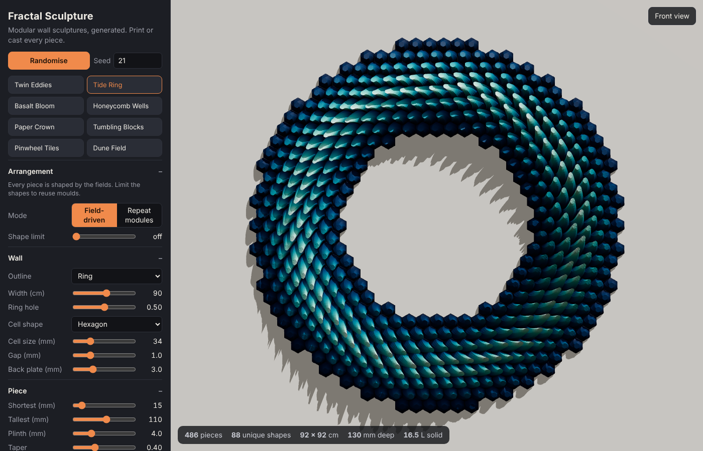

# Fractal Sculpture

A browser-based generator for modular wall sculptures: a grid of pieces whose height, lean,
twist and colour are driven by swirls, attractors, waves and noise. Every design can be exported
as printable pieces and resin moulds.

Inspired by the parametric, field-driven wall sculptures of Herschel Shapiro. The generator
borrows the method (grid + flow fields + a parametric piece); it does not reproduce any of
his works.



## Run it

```bash
npm install
```

```bash
npm run dev
```

`npm run build` writes a static site to `dist/`; `npm test` runs the geometry tests.
The included GitHub Actions workflow publishes `dist/` to GitHub Pages on pushes to `main`
(enable Pages → "GitHub Actions" in the repository settings).

## How a sculpture is made

1. **Wall** – a rectangle, circle, hexagon or ring is filled with hexagon, square, triangle or
   rhombus cells.
2. **Fields** – swirls and attractors (placed from the seed) give each cell a direction; a
   centre-to-edge gradient, bumps near the swirls, a wave and noise give it a height.
3. **Piece** – each cell's footprint is lofted upwards with taper, side curve, lean, twist,
   round-off, a slanted cut and one of six tops (flat, point, dome, bowl, folded crown, step).
4. **Arrangement**
   - *Field-driven*: every piece follows the fields, so most are unique. "Shape limit" snaps
     them to a small set of shapes.
   - *Repeat modules*: one to four identical modules, turned in steps by a rule (follow the
     flow, radial, checker, random, …). One mould per module.

"Avoid clashes" compares neighbouring pieces' cross-sections and holds back twist and lean
until none of them intersect.

## Exports

- **Kit (ZIP)** – `pieces/P001_x12.stl` (one per unique shape, with the quantity),
  `assembly-map.svg` (numbered plan with each piece's orientation), `wall.stl`, `design.json`
  and a `README.txt` parts list. With moulds enabled it also holds, per piece, a
  `*_negative.stl` cavity mould and a `*_silicone_box.stl` master-in-a-cup for pouring a
  silicone mould.
- **Wall STL** – the whole sculpture, optionally on a back plate.
- **PNG** – the current view.
- **Save / load design** – the full parameter set as JSON.

All STL files are in millimetres and watertight. The parts list marks each piece as `rigid`
(pulls straight out of a hard mould) or `flexible` (needs a TPU or silicone mould).

## Limits worth knowing

- Clash checking compares shaft cross-sections at six heights; domes, points and slanted tops
  are not included, and it is a guide rather than a guarantee.
- Lean is capped so overhangs stay near 45°, but supports may still be needed on some printers.
- Moulds are single-part with no vents or pour spouts; deep bowls can trap air.
- Walls are capped at 2,500 pieces (cells grow automatically beyond that).
